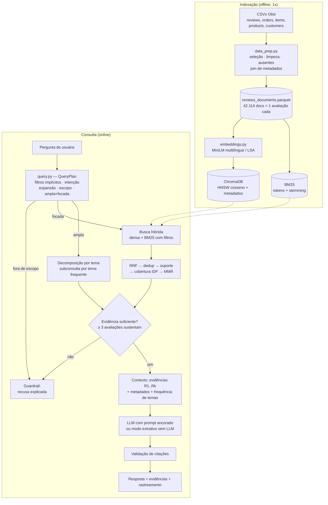

# Voice of Customer Intelligence com RAG — Olist

Tech Challenge — Fase 4 (IA para Devs / POSTECH)

Solução de **Retrieval-Augmented Generation (RAG)** para explorar ~42 mil avaliações escritas
do [Brazilian E-Commerce Public Dataset by Olist](https://www.kaggle.com/datasets/olistbr/brazilian-ecommerce).
Gestores fazem perguntas em linguagem natural ("quais os principais problemas relatados?",
"o que dizem sobre a entrega?") e recebem uma resposta **fundamentada em avaliações reais,
com citações [R1], [R2]… para cada afirmação**, a frequência dos temas na base e o rastreamento
completo de como a resposta foi construída. Quando não há evidência suficiente, o sistema
**recusa responder** em vez de inventar.

---

## Sumário
1. [Arquitetura](#1-arquitetura)
2. [Como executar](#2-como-executar)
3. [Preparação da base de conhecimento](#3-preparação-da-base-de-conhecimento)
4. [Pipeline RAG](#4-pipeline-rag)
5. [Respostas fundamentadas e tratamento de falta de evidências](#5-respostas-fundamentadas-e-tratamento-de-falta-de-evidências)
6. [Metadados e exploração contextual (desafio adicional)](#6-metadados-e-exploração-contextual-desafio-adicional)
7. [Decisões técnicas e justificativas](#7-decisões-técnicas-e-justificativas)
8. [Avaliação](#8-avaliação)
9. [Exemplos de perguntas e respostas](#9-exemplos-de-perguntas-e-respostas)
10. [Limitações conhecidas e próximos passos](#10-limitações-conhecidas-e-próximos-passos)
11. [Estrutura do repositório e tecnologias](#11-estrutura-do-repositório-e-tecnologias)

---

## 1. Arquitetura



Mapa das etapas exigidas no desafio → código:

| Etapa do enunciado | Onde está |
|---|---|
| Pergunta do usuário | `cli.py`, `app/streamlit_app.py` |
| Processamento da pergunta | `query.py` → `plan_query()` |
| Representação vetorial / embeddings | `embeddings.py` |
| Recuperação das avaliações mais relevantes | `retriever.py` → `HybridRetriever.retrieve()` |
| Construção do contexto | `generation.py` → `build_context()` |
| Geração com modelo de linguagem | `generation.py` → `call_llm()` / `extractive_answer()` |
| Resposta fundamentada nas evidências | `pipeline.py` → `RAGResponse` (+ `check_citations()`) |

---

## 2. Como executar

Requisitos: Python 3.10+ e ~1 GB livre em disco.

```bash
git clone https://github.com/Reis-Bruno/tech-challenge-fase-4.git
```

```bash
cd tech-challenge-fase-4
```

```bash
python -m venv .venv && source .venv/bin/activate
```

```bash
pip install -r requirements.txt
```

```bash
cp .env.example .env
```

**1) Baixar os dados** (usa `kagglehub`; precisa de credenciais do Kaggle em `~/.kaggle/kaggle.json`).
Alternativa: baixar o zip manualmente na página do Kaggle e extrair os CSVs em `data/raw/`.

```bash
python scripts/download_data.py
```

**2) Construir a base de conhecimento** (limpeza + metadados → `data/processed/`)

```bash
PYTHONPATH=src python -m voc_rag.data_prep
```

**3) Gerar embeddings e índices** (ChromaDB + BM25 → `data/index/`). O backend padrão
(`fastembed`) baixa o modelo multilíngue (~220 MB) do HuggingFace na primeira execução e leva
alguns minutos em CPU. Sem internet/HuggingFace, use `--backend lsa` (100% offline, ~10 s).

```bash
PYTHONPATH=src python -m voc_rag.indexing --backend fastembed
```

**4) Perguntar** — pela interface web:

```bash
streamlit run app/streamlit_app.py
```

ou pela linha de comando:

```bash
PYTHONPATH=src python -m voc_rag.cli "O que os clientes relatam sobre problemas relacionados à entrega?"
```

```bash
PYTHONPATH=src python -m voc_rag.cli "O que elogiam?" --categoria beleza_saude --ano 2018 --provider openai
```

**Configurar o LLM (Gemini, padrão do projeto)**: crie uma chave gratuita em
<https://aistudio.google.com/apikey> e coloque-a no `.env`:

```bash
echo "GEMINI_API_KEY=sua-chave-aqui" >> .env
```

Com `GEMINI_API_KEY` definida, o projeto usa `gemini-2.5-flash` automaticamente. Sem chave, cai
no modo extrativo. Outros provedores (variável `VOC_LLM_PROVIDER`, opção `--provider` ou seletor na interface):

| Valor | Requer | Observação |
|---|---|---|
| `gemini` (padrão) | `GEMINI_API_KEY` | `gemini-2.5-flash`; camada gratuita suficiente para a demo (há nova tentativa automática em caso de limite de requisições) |
| `none` | nada | resposta **extrativa**: agrupa as evidências por tema e cita os trechos; não escreve conclusões novas |
| `openai` | `OPENAI_API_KEY` | padrão `gpt-4o-mini` |
| `anthropic` | `ANTHROPIC_API_KEY` | padrão `claude-haiku-5-5` |
| `ollama` | Ollama rodando local | padrão `llama3.1:8b`, sem custo e sem enviar dados para fora |

O modelo pode ser trocado com `VOC_LLM_MODEL`. Se a chamada ao LLM falhar, a aplicação cai
automaticamente para a resposta extrativa e avisa.

**5) Testes e avaliação**

```bash
python -m pytest -q
```

```bash
python eval/run_eval.py
```

---

## 3. Preparação da base de conhecimento

Código: [`src/voc_rag/data_prep.py`](src/voc_rag/data_prep.py). Relatório gerado em `data/processed/data_report.json`.

| Passo | Decisão | Por quê |
|---|---|---|
| **Seleção** | Só avaliações com título **ou** comentário (42.687 de 99.224). | 57% das avaliações têm só a nota: sem texto não há "voz do cliente" para recuperar. A nota continua usada como metadado. |
| **Documento** | **1 avaliação = 1 documento**, texto = `título. comentário` (título omitido se já contido no comentário). | Comentários têm no máximo ~230 caracteres (mediana 54): cabem inteiros num embedding. Chunking só fragmentaria a opinião e quebraria a rastreabilidade insight → avaliação. O título carrega sinal útil ("Péssimo", "Recomendo"). |
| **Limpeza** | Remoção de `\r\n`, espaços e pontuação repetida; **acentos e caixa preservados** no texto exibido/embutido. Normalização (minúsculas, sem acento, stemming leve) só nas representações léxicas (BM25, temas, LSA). | A evidência mostrada ao gestor precisa ser fiel ao original; modelos multilíngues lidam bem com acentos. Para casamento léxico, normalizar aumenta recall ("entrega"/"entregá", "atrasou"/"atrasado"). |
| **Stopwords** | Lista curta e conservadora — **negações ("não", "nunca", "nada") são mantidas**. | Em avaliações a negação inverte o sentido ("não chegou"). |
| **Ruído** | Removidos 256 textos sem nenhuma palavra (".", "10", emojis). Textos < 15 caracteres ("Ok", "Bom") ficam no índice, mas não são escolhidos como evidência. | Eles contam como volume, mas não explicam nada. |
| **Duplicatas** | 317 `review_id` repetidos (mesma avaliação ligada a mais de um pedido) → 1 documento. Textos idênticos de pessoas diferentes (6 mil, ex.: "Muito bom") são **mantidos** no índice e colapsados só na hora de exibir ("+N avaliações com texto idêntico"). | São opiniões independentes (contam como frequência), mas repetir a mesma frase 5 vezes no contexto desperdiça a janela do LLM. |
| **Valores ausentes** | Categoria ausente (1.105) → `desconhecida`; data de entrega ausente (1.867 pedidos não entregues) → `delivery_status = nao_entregue` e atraso indefinido (a chave é omitida no Chroma, que não aceita nulos); data da compra ausente → data da avaliação. Título/comentário nulos → string vazia. | Nenhuma avaliação com texto é descartada por falta de metadado; o "não entregue" é informação, não lixo. |
| **Enriquecimento** | Join com pedidos (datas, status, atraso em dias = entrega real − estimada), itens/produtos (categoria do item de maior valor, nº de itens, valor), clientes (UF). | Base para os filtros de metadados (seção 6). |

Resultado: **42.114 documentos**, período 09/2016–10/2018. Distribuição de notas: 1★ 8.707 · 2★ 2.134 · 3★ 3.597 · 4★ 6.180 · 5★ 21.496.
Um dado que já orienta a análise: a **nota média é 4,0 quando o pedido chega no prazo, 1,94 quando atrasa e 1,52 quando não é entregue**.

---

## 4. Pipeline RAG

### 4.1 Transformação da pergunta — [`query.py`](src/voc_rag/query.py)
A pergunta vira um `QueryPlan`, exibido na interface ("Rastreamento do pipeline"):

1. **Normalização** (minúsculas, sem acento) para regras e BM25.
2. **Intenção/polaridade**: "problemas", "reclamações" → negativa; "elogiam", "valorizam" → positiva.
3. **Filtros de metadados implícitos**: intenção negativa → nota ≤ 3 (≤ 2 se "insatisfeitos"/"nota baixa", porque nota 3 costuma ser um problema parcial); positiva → nota ≥ 4; "nota N"; anos citados; categorias por apelido ("celular" → `telefonia`, "beleza" → `beleza_saude`); "entregas atrasadas" → `delivery_status = atrasado`.
4. **Expansão de consulta** só para o BM25, com sinônimos do domínio (entrega → prazo, atraso, correios, transportadora…). O vetor denso usa a pergunta original: o modelo já captura a semântica e termos extras diluiriam o vetor.
5. **Termos de conteúdo × moldura**: tira palavras de "moldura" ("quais", "principais", "clientes", "avaliações", "problemas") e vê o que sobra. Se não sobra nada, a pergunta é **ampla**; se sobra (ex.: `entreg`, `qualidade`), é **focada**.
6. **Escopo**: perguntas que exigem dados transacionais (faturamento, nº de pedidos) são recusadas; perguntas sem nenhum termo do domínio passam a exigir evidência léxica forte.

Escolhemos **regras determinísticas** em vez de um LLM nesta etapa: são auditáveis, instantâneas, gratuitas, funcionam sem chave de API e cada filtro aplicado aparece para o usuário (que pode desligar a inferência ou sobrescrever os filtros na barra lateral).

### 4.2 Recuperação — [`retriever.py`](src/voc_rag/retriever.py)

**Pergunta focada** ("o que relatam sobre a entrega?"):

1. **Busca densa** no ChromaDB (top 60, cosseno, com filtro `where` dos metadados).
2. **Busca léxica BM25** (top 60, mesmos filtros, com consulta expandida).
3. **Fusão por Reciprocal Rank Fusion** (k = 60): combina os rankings sem calibrar escalas incomparáveis (cosseno × BM25). A densa acha paráfrases ("não chegou até hoje" ≈ "atraso"); o BM25 garante termos exatos e raros (nomes de produtos, "drone", "PAC").
4. **Deduplicação** de textos idênticos e descarte de textos curtíssimos.
5. **Verificação de suporte**: o candidato só vira evidência se compartilha um termo de conteúdo da pergunta (ou da expansão) **ou** passa do limiar de similaridade densa do backend.
6. **Reordenação por cobertura**: relevância = RRF × (0,5 + fração ponderada por IDF dos termos da pergunta presentes na avaliação). Favorece quem trata de *todos* os aspectos perguntados ("diferente" + "anúncio"), não só do termo mais comum ("receber").
7. **MMR** (λ = 0,7) para escolher as *k* = 10 finais: evita 10 variações de "entrega atrasada" e cobre aspectos diferentes (atraso, falta de rastreio, correios…).

**Pergunta ampla** ("quais os principais problemas?") — **decomposição em subconsultas por tema**:
top-k puro numa pergunta genérica devolve avaliações *parecidas com o texto da pergunta*
(com a palavra "problema", inclusive "entrega **sem** problemas"), não as *representativas*.
Por isso o sistema (a) calcula a frequência de cada tema na população filtrada, (b) cria uma
subconsulta para cada um dos 4 temas mais frequentes e (c) busca, entre as avaliações que
**contêm** o tema, as mais próximas semanticamente, com MMR. Cada evidência fica vinculada ao
tema que sustenta.

### 4.3 Construção do contexto — [`generation.py`](src/voc_rag/generation.py)
```
FILTROS APLICADOS: nota 1–3
AVALIAÇÕES NA POPULAÇÃO FILTRADA: 14438
EVIDÊNCIAS:
[R2] (nota 3/5 | compra 2018-02-17 | categoria bebes | entregue com 9 dia(s) de atraso | UF SP)
"Produto com o prazo de entrega atrasado"
...
ESTATÍSTICAS DE TEMAS ENTRE AS AVALIAÇÕES QUE MENCIONAM O ASSUNTO (base: 8131 avaliações)
- Produto não recebido (até a data da avaliação): 3248 (39.9%)
- Atraso / demora na entrega: 1812 (22.3%)
...
```
Cada evidência leva seus metadados, para o modelo poder relacionar relato e contexto (ex.: o
cliente reclama e o pedido de fato atrasou 9 dias). As **estatísticas de temas** resolvem uma
limitação estrutural do RAG: 10 avaliações não dizem nada sobre *frequência*. Por isso a
contagem determinística entra no contexto, e o prompt instrui o modelo a usá-la ao falar de
"mais frequente".

### 4.4 Geração
O *system prompt* exige: usar **somente** o contexto, citar `[R#]` em cada afirmação, não generalizar a partir de 1 avaliação, declarar "Não há evidências suficientes…" quando for o caso e fechar com uma linha de limitações. A temperatura é 0,1, para respostas estáveis e conservadoras.
Sem LLM, o **modo extrativo** monta a resposta agrupando as evidências por tema e citando os trechos literais, o que garante fidelidade total às evidências.

### 4.5 Pós-validação
`check_citations()` substitui citações a evidências inexistentes (ex.: `[R40]` quando só há 10) por "[citação inválida]", sinaliza respostas sem nenhuma citação e mede a cobertura de citações. Os avisos aparecem na interface.

---

## 5. Respostas fundamentadas e tratamento de falta de evidências

O sistema recusa (gerador `guardrail`, **sem chamar o LLM**) nestes casos:

| Situação | Como é detectada |
|---|---|
| Pergunta fora do escopo da base (ex.: "capital da França") | nenhum termo do domínio **e** nenhuma avaliação cobre ≥ 60% (ponderado por IDF) dos termos da pergunta com similaridade acima do limiar |
| Pergunta que exige dados que não estão nos textos (ex.: "faturamento em 2018") | lista de pistas de dados transacionais/financeiros |
| Evidências insuficientes | menos de 3 avaliações sustentam a pergunta (parâmetro `min_evidence`) |
| Filtros sem resultado | população filtrada vazia |

A recusa explica o motivo e sugere como reformular. A recusa vem **antes** do LLM por dois
motivos: não depender de o modelo "obedecer" ao prompt e não gastar tokens. O prompt ainda traz
uma segunda linha de defesa (regra 3), para os casos em que há avaliações relacionadas que não
respondem de fato à pergunta.

---

## 6. Metadados e exploração contextual (desafio adicional)

Cada documento no ChromaDB carrega: `review_score`, `sentiment`, `purchase_date/year/yyyymm`,
`delivery_status`, `delay_days`, `category`, `customer_state`, `order_value`.

Como os metadados melhoram a recuperação:
- **Precisão por construção**: o filtro é aplicado *dentro* da busca vetorial e do BM25, não depois. "O que elogiam em beleza?" busca só entre avaliações 4–5★ de `beleza_saude`. Sem o filtro, a busca semântica por "elogio" traria avaliações negativas que citam a palavra.
- **Perguntas impossíveis só com texto**: "temas em pedidos *entregues com atraso*" usa o atraso calculado (entrega real − estimada), que o cliente nem sempre menciona.
- **Contexto mais rico para o LLM**: cada evidência mostra nota, data, categoria e atraso real, o que permite cruzar relato e fato.
- **Frequências relativas à população certa**: "31,9% das avaliações 1–2★ relatam não ter recebido o produto" é uma afirmação muito mais útil que "aparece em 3 das 10 evidências".

Filtros manuais (nota, ano, categoria, situação da entrega) ficam na barra lateral da interface e em `--nota-min/--nota-max/--ano/--categoria/--entrega` na CLI.

---

## 7. Decisões técnicas e justificativas

| Decisão | Alternativas consideradas | Justificativa |
|---|---|---|
| **Embeddings `paraphrase-multilingual-MiniLM-L12-v2`** (384d) via **fastembed/ONNX** | OpenAI `text-embedding-3`, `multilingual-e5-large`, BERTimbau | Treinado para similaridade de frases em 50+ idiomas (inclui PT-BR); roda em CPU sem PyTorch e sem custo por token; 42 mil textos curtos indexam em minutos. Modelos maiores (e5-large, 2,2 GB) trazem ganho marginal para textos de ~50 caracteres a um custo de indexação ~10× maior. |
| **Backend alternativo LSA** (TF-IDF + SVD 256d) | — | Baseline reprodutível e fallback 100% offline (ambientes sem acesso ao HuggingFace, CI). Usa o mesmo pré-processamento do BM25. |
| **ChromaDB** como banco vetorial | FAISS, Qdrant, pgvector | Persistência local sem servidor, HNSW e **filtros de metadados nativos** (`where`) na mesma consulta — essencial para a seção 6. FAISS exigiria implementar os filtros à parte; Qdrant/pgvector exigiriam infraestrutura. |
| **Busca híbrida (densa + BM25) com RRF** | só densa; só BM25; soma ponderada de escores | Avaliações misturam paráfrases (para a densa) e termos exatos/raros (para o BM25). O RRF dispensa normalizar escores de escalas diferentes e é robusto sem ajuste. |
| **MMR** | top-k puro | Em avaliações, os vizinhos mais próximos costumam ser quase idênticos; o MMR aumenta a cobertura de aspectos com o mesmo k. |
| **Decomposição por tema para perguntas amplas** | top-k puro | Ver 4.2: evidências representativas em vez de "parecidas com a pergunta". |
| **Taxonomia de temas por regex** | clustering (BERTopic), classificação por LLM | Determinística, explicável, instantânea e sem custo; dá frequências auditáveis. A troca é que tem recall limitado (seção 10). |
| **Regras para transformar a pergunta** | LLM para *query rewriting*/HyDE | Ver 4.1. Um LLM aqui adicionaria latência, custo e não-determinismo justamente na etapa que define *quais dados* entram no contexto. |
| **Guardrail antes do LLM** | confiar só no prompt | Ver 5. |
| **Vários provedores de LLM + modo extrativo** | um provedor fixo | A avaliação não fica refém de uma chave de API; com Ollama, os dados não saem da máquina. |

**Parâmetros** (`config.RetrievalConfig`): 60+60 candidatos, RRF k = 60 (valor do artigo
original de Cormack et al.), k final = 10 (cabe folgado no contexto e permite ler todas as
evidências na interface), MMR λ = 0,7, mínimo de 3 evidências, limiar denso 0,45 (fastembed) e
0,20 (LSA).

---

## 8. Avaliação

`eval/run_eval.py` roda 18 perguntas ([`eval/questions.json`](eval/questions.json)): 12 respondíveis (todos os exemplos do enunciado, mais atendimento, produto diferente do anunciado, embalagem e nota baixa) e 6 que devem ser recusadas (fora do domínio ou dependentes de dados transacionais). Métricas:

- **Acurácia do guardrail**: decidiu corretamente entre responder e recusar.
- **Precisão@k (proxy léxico)**: fração das evidências que contêm termos do assunto (padrão definido por pergunta). Subestima paráfrases, mas é reprodutível sem rotulagem manual.
- **Conformidade de filtros**: evidências que respeitam os filtros aplicados.
- **Citações inválidas / respostas sem citação** (com LLM).

Resultado com o backend **LSA** e o gerador **extrativo** (a configuração que roda sem internet): guardrail 18/18, precisão@k proxy média 0,97, filtros 100%, latência média ~0,2 s por pergunta. Detalhes por pergunta em [`docs/avaliacao.md`](docs/avaliacao.md).

> **Leia esses números com ceticismo.** O conjunto é pequeno (18 perguntas), foi escrito pela própria equipe e várias perguntas foram usadas durante o desenvolvimento para ajustar regras e limiares. Há, portanto, risco real de sobreajuste. O proxy de precisão mede se a evidência *fala do assunto*, não se ela *sustenta a conclusão*. Antes de qualquer conclusão de negócio, o próximo passo é avaliar com perguntas novas, escritas por quem não desenvolveu o sistema, e rotulagem humana de relevância. Rode `python eval/run_eval.py` de novo após indexar com `fastembed` e após configurar um LLM: o limiar denso do fastembed (0,45) é um ponto de partida e deve ser recalibrado com esse script.

---

## 9. Exemplos de perguntas e respostas

Todas as respostas de exemplo, com as tabelas de evidências, estão em [`docs/exemplos.md`](docs/exemplos.md) (geradas por `eval/run_eval.py`, backend LSA, gerador extrativo). Trechos:

**"Quais são os principais problemas relatados pelos clientes em suas avaliações?"**
modo `amplo` · filtro inferido nota 1–3 · 14.438 avaliações

```text
Resumo: nas 14438 avaliações analisadas (nota 1–3), os temas mais citados são: produto não
recebido (até a data da avaliação) (26.6%), atraso / demora na entrega (13.1%), troca,
devolução, cancelamento ou reembolso (12.1%).
- Produto não recebido (até a data da avaliação) [R1] [R2]
    • "PRODUTO NÃO RECEBIDO" [R1]
- Atraso / demora na entrega [R3] [R4]
    • "Demora na entrega e ainda atrasou." [R3]
...
```

**"Qual foi o faturamento da Olist em 2018?"** → recusada:
```text
Não há evidências suficientes na base de avaliações para responder. Motivo: A pergunta exige
dados transacionais/financeiros agregados, que não estão nos textos das avaliações...
```

**"Qual a capital da França?"** → recusada: nenhuma avaliação tem relação verificável com a pergunta.

---

## 10. Limitações conhecidas e próximos passos

- **Os exemplos e a avaliação publicados usam o backend LSA e o modo extrativo.** O ambiente de desenvolvimento não tinha acesso ao HuggingFace nem a APIs de LLM. O caminho `fastembed` + LLM está implementado (e o fluxo do LLM foi testado com um modelo simulado, incluindo a remoção de citações inválidas), mas os números com ele precisam ser gerados localmente (seção 8).
- **Taxonomia de temas por palavras-chave**: cerca de 39% das avaliações não casam com nenhum tema, e negações distantes ("não achei que fosse chegar tão rápido") podem confundir os padrões. Os percentuais são estimativas de piso, e a interface deixa isso explícito. Próximo passo: descobrir temas por clustering de embeddings (ex.: BERTopic) e classificar com LLM numa amostra para medir precisão e recall dos padrões.
- **"Produto não recebido" ≠ "nunca entregue"**: muitas avaliações são escritas antes da entrega. Entre as 3.809 avaliações de pedidos que *foram entregues, com atraso*, 45,9% dizem algo como "não recebi". O rótulo do tema deixa isso claro ("até a data da avaliação"), e o metadado `delivery_status` mostra o que de fato aconteceu.
- **Regras de consulta em português** cobrem os padrões de pergunta mais comuns. Perguntas muito diferentes podem não acionar filtros (o usuário pode aplicá-los manualmente). Uma evolução é usar um LLM para extrair filtros num JSON validado contra o esquema, mantendo as regras como fallback.
- **Nota 3 na intenção negativa** é uma escolha de recall: entram reclamações parciais, mas também alguns elogios moderados.
- O sistema descreve o que os clientes **dizem**; não infere causa (ex.: se o atraso foi da transportadora ou do vendedor), a não ser que as próprias avaliações digam.

---

## 11. Estrutura do repositório e tecnologias

```
├── app/streamlit_app.py        # interface web (resposta, evidências, temas, rastreamento)
├── src/voc_rag/
│   ├── config.py               # caminhos, provedores, hiperparâmetros
│   ├── text.py                 # limpeza, normalização, stemming leve
│   ├── data_prep.py            # 1. construção da base de conhecimento
│   ├── embeddings.py           # backends fastembed (MiniLM multilíngue) e LSA
│   ├── indexing.py             # ChromaDB + BM25 + matriz de embeddings
│   ├── query.py                # 2. transformação da pergunta (QueryPlan, filtros, escopo)
│   ├── themes.py               # taxonomia de temas e frequências
│   ├── retriever.py            # 3. recuperação híbrida, RRF, MMR, suficiência
│   ├── generation.py           # 4. contexto, prompt, LLMs, modo extrativo, citações
│   ├── pipeline.py             # orquestração ponta a ponta
│   └── cli.py                  # linha de comando
├── scripts/download_data.py    # download via kagglehub
├── eval/                       # perguntas de avaliação + script
├── docs/                       # avaliação, exemplos, roteiro do vídeo
├── tests/                      # testes unitários e de integração (pytest)
├── requirements.txt · .env.example · pyproject.toml
```

**Tecnologias**: Python 3.10+, pandas/pyarrow, scikit-learn (TF-IDF/SVD), fastembed (ONNX Runtime), ChromaDB, rank-bm25, Streamlit, SDKs OpenAI / Google GenAI / Anthropic (opcionais), Ollama (opcional), kagglehub, pytest.
