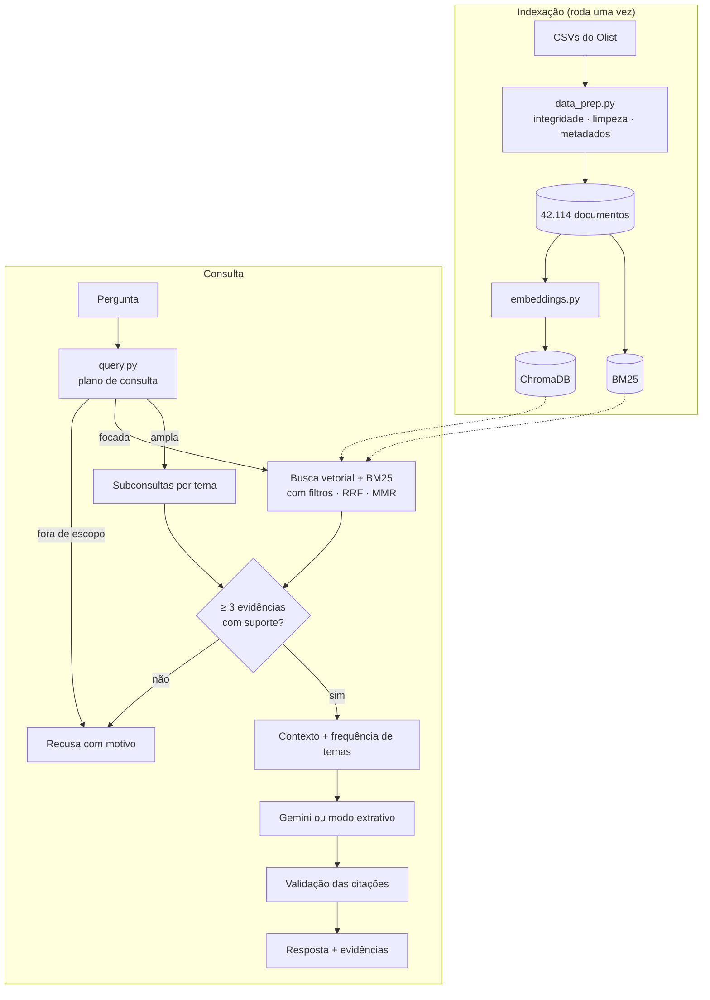

# Voice of Customer Intelligence com RAG — avaliações do Olist

Tech Challenge da Fase 4 — Pós Tech FIAP (IA para Devs)

Aplicação de RAG (Retrieval-Augmented Generation) sobre as avaliações escritas do
[Brazilian E-Commerce Public Dataset by Olist](https://www.kaggle.com/datasets/olistbr/brazilian-ecommerce).
Você faz uma pergunta em português, a aplicação busca as avaliações relacionadas e gera uma
resposta em que cada afirmação cita as avaliações usadas (`[R1]`, `[R2]`…). Sem evidência
suficiente, ela recusa e diz por quê.

## 1. Ideia geral

Na base do Olist, a nota média das avaliações com texto é 4,0 quando o pedido chega no prazo,
1,94 quando atrasa e 1,52 quando não é entregue. A nota diz se o cliente ficou satisfeito; o
motivo está no comentário.

O RAG mais simples (buscar os comentários mais parecidos com a pergunta e pedir um resumo)
falhou em três situações, que definiram o desenho do projeto:

- **Perguntas amplas** ("quais os principais problemas?") traziam avaliações parecidas com o
  texto da pergunta, como "Entrega sem problemas". Solução: decompor a pergunta pelos temas
  mais frequentes.
- **Perguntas de frequência** não se respondem com dez avaliações. Solução: contar os temas na
  base inteira e enviar a contagem junto com as evidências.
- **Perguntas sem resposta na base** recebiam resposta mesmo assim. Solução: verificar se há
  evidência suficiente antes de chamar o modelo.

## 2. Arquitetura



| Etapa do enunciado | Onde está |
|---|---|
| Processamento da pergunta | `src/voc_rag/query.py` |
| Embeddings | `embeddings.py` |
| Recuperação | `retriever.py` |
| Construção do contexto e geração | `generation.py` |
| Orquestração e resposta fundamentada | `pipeline.py` |
| Interfaces | `app/streamlit_app.py`, `cli.py` |

## 3. Como rodar

Python 3.10+ e cerca de 1 GB de disco. No Windows/PowerShell, troque `PYTHONPATH=src` por
`$env:PYTHONPATH = "src"` antes dos comandos.

```bash
git clone https://github.com/Reis-Bruno/tech-challenge-fase-4.git
```

```bash
cd tech-challenge-fase-4
```

```bash
pip install -r requirements.txt
```

**Dados.** Baixa a base do Kaggle com `kagglehub` (na nossa execução, não pediu credenciais).
Alternativa: baixar o zip pelo site e extrair os CSVs em `data/raw/`.

```bash
python scripts/download_data.py
```

**Base e índices.** O primeiro uso do `fastembed` baixa o modelo (cerca de 220 MB) do
HuggingFace.

```bash
PYTHONPATH=src python -m voc_rag.data_prep
```

```bash
PYTHONPATH=src python -m voc_rag.indexing --backend fastembed
```

**Modelo de linguagem.** Crie uma chave em <https://aistudio.google.com/apikey> e grave no
`.env` na forma `GEMINI_API_KEY=sua-chave`. Sem chave, a aplicação usa o modo extrativo, que
organiza as evidências por tema sem redigir conclusões.

**Uso.**

```bash
streamlit run app/streamlit_app.py
```

```bash
PYTHONPATH=src python -m voc_rag.cli "O que os clientes relatam sobre problemas relacionados à entrega?"
```

**Testes e experimentos.**

```bash
python -m pytest -q
```

```bash
python eval/ablation.py
```

```bash
python eval/run_eval.py --provider gemini
```

O notebook [`notebooks/demonstracao_pipeline.ipynb`](notebooks/demonstracao_pipeline.ipynb)
mostra as etapas do pipeline com as saídas já executadas.

## 4. Base de conhecimento

| Etapa | Quantidade |
|---|---|
| Avaliações no CSV | 99.224 |
| Com título ou comentário | 42.687 |
| − `review_id` repetido (mesma avaliação em mais de um pedido) | −317 |
| − textos sem nenhuma palavra (só pontuação, números ou símbolos) | −256 |
| **Documentos indexados** | **42.114** |

- **Integridade.** Antes de transformar os dados, o script confere chaves e leitura do CSV:
  nenhuma nota fora de 1–5, apesar de 3.852 comentários com quebra de linha; categoria agregada
  por pedido, porque 9.803 pedidos têm mais de um item e um join direto duplicaria avaliações.
- **Uma avaliação = um documento.** O maior texto tem cerca de 230 caracteres; dividir em
  trechos só atrapalharia a ligação entre evidência e avaliação.
- **Limpeza leve** no texto exibido (acentos preservados). A normalização pesada (minúsculas,
  sem acento, radicais) vale só para o BM25 e os temas. Negações nunca são removidas.
- **Ausentes.** Nenhuma avaliação com texto é descartada: categoria ausente vira
  `desconhecida`, pedido sem data de entrega vira `nao_entregue`.
- **Metadados:** nota, data da compra, situação da entrega, atraso em relação à data
  estimada, categoria, UF e valor do pedido.

## 5. Pipeline RAG

1. **Plano de consulta** (`query.py`). Regras extraem a intenção e os filtros (problemas →
   notas 1 a 3; elogios → 4 e 5; ano; categoria; "entregues com atraso"), sinônimos para o
   BM25 e os termos de conteúdo. Sem termo de conteúdo, a pergunta é tratada como ampla.
   Perguntas sobre faturamento ou número de pedidos são recusadas aqui. Usei regras, e não um
   LLM, para que a mesma pergunta gere sempre o mesmo plano, visível na interface.
2. **Recuperação** (`retriever.py`). Na pergunta focada: busca vetorial no ChromaDB e BM25 (60
   candidatos cada, com os filtros), fusão por RRF, verificação de suporte, reordenação pela
   cobertura dos termos (ponderada por IDF) e escolha de 10 evidências por MMR. Na pergunta
   ampla: duas evidências para cada um dos 4 temas mais frequentes da população filtrada.
3. **Contexto e geração** (`generation.py`). Evidências numeradas com seus metadados e um
   bloco de frequência de temas. O prompt exige citar as evidências e declarar falta de
   evidência. Depois da geração, citações a evidências inexistentes são removidas.
4. **Recusa.** O modelo não é chamado se a pergunta pede dados que não estão nos textos, se
   nenhuma avaliação cobre 60% dos seus termos (perguntas de fora do domínio) ou se há menos de
   três avaliações com suporte.

| Escolha | Motivo |
|---|---|
| Embeddings `paraphrase-multilingual-MiniLM-L12-v2` (fastembed) | suporta português e roda em CPU, sem custo por chamada |
| ChromaDB | local e com filtro de metadados na própria busca |
| Busca híbrida com RRF | paráfrases (vetorial) e termos exatos (BM25), sem calibrar escalas |
| Temas por palavras-chave | contagem reproduzível sobre a base inteira |
| Recusa antes do LLM | não depende de o modelo obedecer ao prompt |

## 6. Problemas encontrados

| Problema | O que mudou |
|---|---|
| "Principais problemas" trazia "Entrega sem problemas" | decomposição por tema nas perguntas amplas |
| "Como fazer um bolo de chocolate?" era aceita (muitas avaliações têm o verbo "fazer") | cobertura ponderada por IDF para perguntas fora do domínio |
| "Clientes insatisfeitos" contava como pergunta positiva ("insatisfeitos" contém "satisfeit") | pista positiva só no início da palavra |
| "Sem defeitos" era contado como defeito | negações explícitas removidas antes de contar temas |
| 45,9% das avaliações de pedidos entregues com atraso diziam "não recebi" | muitas são escritas antes da entrega; o tema virou "não recebido (até a data da avaliação)" |
| Alerta falso de resposta sem citação (o Gemini escreve `[R1, R2]`) | o validador passou a aceitar citações agrupadas |
| Modelo do Gemini indisponível ou sobrecarregado (erro 503) | nova tentativa e troca para um modelo reserva |

## 7. Resultados

Execução com a base baixada do Kaggle, embeddings fastembed e geração pelo Gemini, em 18
perguntas ([`eval/questions.json`](eval/questions.json)): 12 respondíveis, incluindo todos os
exemplos do enunciado, e 6 que devem ser recusadas.

**Ablação da recuperação** ([`docs/ablacao.md`](docs/ablacao.md)), sem LLM:

| Variante | Precisão | Polaridade | Recusas (de 6) |
|---|---|---|---|
| A. Só vetorial (top-k) | 0,71 | 0,82 | 2 |
| B. Só BM25 | 0,79 | 0,62 | 2 |
| C. Híbrida (RRF) | 0,75 | 0,76 | 2 |
| D. C + filtros inferidos | 0,80 | 1,00 | 2 |
| E. D + suporte e cobertura IDF | 0,84 | 1,00 | 6 |
| F. E + MMR | 0,82 | 1,00 | 6 |
| G. Pipeline completo (F + decomposição por tema) | 0,93 | 1,00 | 6 |

*Precisão*: fração das evidências que contêm termos do assunto (proxy léxico). *Polaridade*:
fração das evidências com nota coerente com a pergunta.

Os filtros corrigem a nota das evidências, a verificação de suporte é o que recusa as
perguntas de fora do domínio e a decomposição por tema dá o maior ganho de precisão. Três
ressalvas: a polaridade 1,00 é efeito direto do filtro; o ganho de G está inflado, porque os
padrões que escolhem as evidências se parecem com os que medem a precisão; e **o BM25 sozinho
teve precisão maior que a busca híbrida**, de modo que a vantagem da híbrida não foi
confirmada (ela só foi melhor em polaridade).

**Avaliação de ponta a ponta** ([`docs/avaliacao.md`](docs/avaliacao.md)): 18 de 18 decisões
corretas entre responder e recusar, precisão das evidências de 0,93, nenhuma citação inválida
e nenhuma resposta sem citação. Cada resposta leva cerca de 12 s, quase tudo na chamada ao
Gemini.

**Exemplo** (as 18 respostas estão em [`docs/exemplos.md`](docs/exemplos.md)) — "Quais são os
principais problemas relatados pelos clientes em suas avaliações?":

```text
Os principais problemas relatados pelos clientes envolvem atrasos e não entrega de pedidos,
envio de produtos errados ou de baixa qualidade, além de falhas no atendimento e cancelamentos
sem justificativa. [...]
- Não entrega e atrasos de envio: [...] [R1] [R2] [R3] [R4]. [...] o tema "Produto não
  recebido (até a data da avaliação)" representa 26,6% (3.845 avaliações) e "Atraso / demora
  na entrega" representa 13,1% (1.896 avaliações).
- Recebimento de produto errado ou divergente: [...] [R6] [R7] [R8]. [...]
```

## 8. Limitações

- **Avaliação pequena e feita por mim.** As 18 perguntas foram escritas durante o
  desenvolvimento e usadas para ajustar regras; os números estão otimistas. A precisão mede se
  a evidência fala do assunto, não se sustenta a conclusão.
- **Limiar de similaridade não calibrado.** O valor de 0,45 não decide nenhuma das 18
  perguntas; calibrá-lo exige perguntas novas, de borda.
- **Temas por palavras-chave.** Cerca de 39% das avaliações não caem em nenhum tema, então os
  percentuais são um piso.
- **Regras de interpretação** cobrem as formulações que previ; fora delas, os filtros podem
  ser aplicados manualmente na interface.
- **Não testados:** os provedores OpenAI, Anthropic e Ollama estão implementados, mas nunca
  foram executados. O backend LSA existe como alternativa sem HuggingFace, sem resultados
  publicados.
- **Escala:** tudo roda localmente, com índices em memória, adequado a dezenas de milhares de
  avaliações.

## 9. Estrutura

```
├── app/streamlit_app.py      interface web
├── src/voc_rag/              data_prep, embeddings, indexing, query, themes,
│                             retriever, generation, pipeline, cli
├── notebooks/                demonstração executada do pipeline
├── eval/                     perguntas, avaliação e ablação
├── docs/                     resultados, exemplos e roteiro do vídeo
├── scripts/download_data.py  download da base via kagglehub
└── tests/                    testes unitários e de integração
```

Tecnologias: Python, pandas, scikit-learn, fastembed, ChromaDB, rank-bm25, Streamlit, Google
GenAI SDK, kagglehub e pytest.
