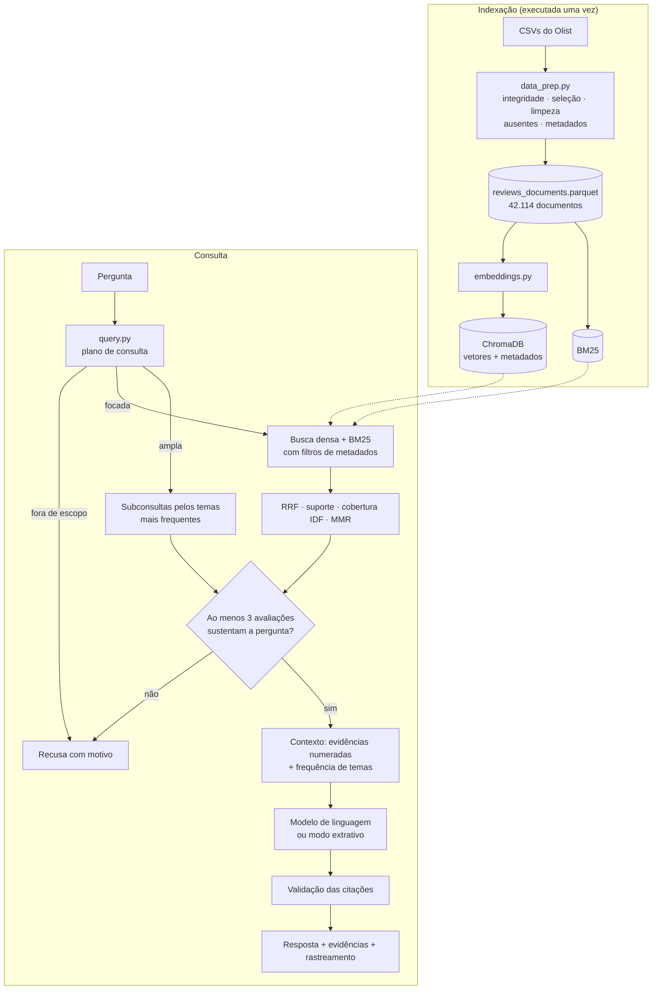

# Voice of Customer Intelligence com RAG — avaliações do Olist

Tech Challenge da Fase 4 — Pós Tech FIAP (IA para Devs)

Este repositório contém uma solução de Retrieval-Augmented Generation (RAG) sobre as avaliações
escritas do [Brazilian E-Commerce Public Dataset by Olist](https://www.kaggle.com/datasets/olistbr/brazilian-ecommerce).
A aplicação recebe uma pergunta em linguagem natural, recupera as avaliações relacionadas e
gera uma resposta em que cada afirmação cita as avaliações que a sustentam (`[R1]`, `[R2]`…).
Quando a base não tem evidência suficiente para a pergunta, a aplicação recusa a resposta e
explica o motivo.

O texto abaixo descreve o que foi construído, por que cada decisão foi tomada e o que os
experimentos mostraram, incluindo o que ainda não está resolvido.

## Sumário

1. [Problema e abordagem](#1-problema-e-abordagem)
2. [Arquitetura](#2-arquitetura)
3. [Instalação e execução](#3-instalação-e-execução)
4. [Preparação da base de conhecimento](#4-preparação-da-base-de-conhecimento)
5. [Pipeline RAG](#5-pipeline-rag)
6. [Evidências e recusa de resposta](#6-evidências-e-recusa-de-resposta)
7. [Uso de metadados](#7-uso-de-metadados)
8. [Decisões técnicas](#8-decisões-técnicas)
9. [Experimentos e resultados](#9-experimentos-e-resultados)
10. [Exemplos de perguntas e respostas](#10-exemplos-de-perguntas-e-respostas)
11. [Limitações e trabalhos futuros](#11-limitações-e-trabalhos-futuros)
12. [Estrutura do repositório](#12-estrutura-do-repositório)

## 1. Problema e abordagem

A base do Olist tem 99.224 avaliações, das quais 42.687 trazem algum texto. A nota indica o
grau de satisfação, mas o motivo está no comentário. Dois números da própria base mostram por
que o texto importa: a nota média é 4,0 quando o pedido chega no prazo, 1,94 quando chega com
atraso e 1,52 quando não é entregue.

Uma solução de RAG simples (vetorizar os comentários, buscar os *k* mais próximos e pedir um
resumo ao modelo) atende parte das perguntas do enunciado, mas falha em três situações que
encontramos logo nos primeiros testes:

- **Perguntas amplas.** Para "quais são os principais problemas?", os vizinhos mais próximos
  são avaliações parecidas com o texto da pergunta, como "Entrega sem problemas", e não as
  avaliações representativas dos problemas mais comuns.
- **Perguntas sobre frequência.** Dez avaliações recuperadas não permitem afirmar o que é
  "mais frequente" em dezenas de milhares.
- **Perguntas sem resposta na base.** Um modelo de linguagem instruído a "responder só com o
  contexto" ainda tende a responder alguma coisa.

O projeto foi organizado em torno desses três pontos: uma etapa de interpretação da pergunta
que distingue perguntas amplas de focadas, uma contagem determinística de temas que acompanha
as evidências, e uma verificação de suficiência que antecede a chamada ao modelo.

## 2. Arquitetura



Cada etapa do fluxo pedido no enunciado corresponde a um módulo:

| Etapa | Implementação |
|---|---|
| Pergunta do usuário | `app/streamlit_app.py`, `src/voc_rag/cli.py` |
| Processamento da pergunta | `query.py`, função `plan_query` |
| Representação vetorial | `embeddings.py` |
| Recuperação das avaliações | `retriever.py`, classe `HybridRetriever` |
| Construção do contexto | `generation.py`, função `build_context` |
| Geração da resposta | `generation.py`, funções `call_llm` e `extractive_answer` |
| Resposta fundamentada | `pipeline.py`, classe `VoCPipeline`, e `check_citations` |

## 3. Instalação e execução

Requisitos: Python 3.10 ou superior e cerca de 1 GB de disco.

```bash
git clone https://github.com/Reis-Bruno/tech-challenge-fase-4.git
```

```bash
cd tech-challenge-fase-4
```

```bash
python -m venv .venv && source .venv/bin/activate
```

```bash
pip install -r requirements.txt
```

```bash
cp .env.example .env
```

**Dados.** O script abaixo usa `kagglehub` e requer credenciais do Kaggle
(`~/.kaggle/kaggle.json`). Também é possível baixar o arquivo pelo site e extrair os CSVs em
`data/raw/`.

```bash
python scripts/download_data.py
```

**Base de conhecimento.** Gera `data/processed/reviews_documents.parquet` e o relatório
`data_report.json`.

```bash
PYTHONPATH=src python -m voc_rag.data_prep
```

**Índices.** O backend `fastembed` baixa o modelo de embeddings (cerca de 220 MB) do
HuggingFace na primeira execução. Em ambientes sem esse acesso, `--backend lsa` constrói um
índice equivalente sem depender de rede.

```bash
PYTHONPATH=src python -m voc_rag.indexing --backend fastembed
```

**Modelo de linguagem.** O provedor padrão é o Gemini. Basta criar uma chave em
<https://aistudio.google.com/apikey> e registrá-la no `.env`:

```bash
echo "GEMINI_API_KEY=sua-chave" >> .env
```

| `VOC_LLM_PROVIDER` | Requisito | Modelo padrão |
|---|---|---|
| `gemini` | `GEMINI_API_KEY` | `gemini-3.5-flash` (reserva: `gemini-3.5-flash-lite`) |
| `openai` | `OPENAI_API_KEY` | `gpt-4o-mini` |
| `anthropic` | `ANTHROPIC_API_KEY` | `claude-haiku-5-5` |
| `ollama` | servidor Ollama local | `llama3.1:8b` |
| `none` | nenhum | modo extrativo, sem modelo de linguagem |

Sem `VOC_LLM_PROVIDER` definido, a aplicação usa o Gemini se houver chave e o modo extrativo
caso contrário. O modelo pode ser trocado por `VOC_LLM_MODEL`. Dos provedores, apenas o Gemini
e o modo extrativo foram executados de ponta a ponta neste trabalho.

**Aplicação.**

```bash
streamlit run app/streamlit_app.py
```

```bash
PYTHONPATH=src python -m voc_rag.cli "O que os clientes relatam sobre problemas relacionados à entrega?"
```

A CLI aceita filtros explícitos (`--nota-min`, `--nota-max`, `--ano`, `--categoria`,
`--entrega`) e `--json` para a saída completa.

**Testes, avaliação e ablação.**

```bash
python -m pytest -q
```

```bash
python eval/run_eval.py
```

```bash
python eval/ablation.py
```

O notebook [`notebooks/demonstracao_pipeline.ipynb`](notebooks/demonstracao_pipeline.ipynb)
percorre as etapas do pipeline com as saídas já executadas.

## 4. Preparação da base de conhecimento

Código em [`src/voc_rag/data_prep.py`](src/voc_rag/data_prep.py).

### 4.1 Verificação de integridade

Antes de qualquer transformação, o script confere as chaves entre as tabelas e a leitura do
CSV. Os valores abaixo são os observados na base:

| Verificação | Ocorrências | Consequência para o projeto |
|---|---|---|
| Avaliações sem pedido correspondente | 0 | o join com pedidos não perde avaliações |
| Pedidos sem cliente | 0 | UF disponível para todos os pedidos |
| Itens sem produto | 0 | categoria recuperável sempre que há item |
| Pedidos sem itens | 775 | categoria ausente; tratada como `desconhecida` |
| Produtos sem categoria | 610 | idem |
| Notas fora do intervalo 1–5 | 0 | confirma que o CSV foi lido sem desalinhar colunas |
| Comentários com quebra de linha | 3.852 | exigem leitor que respeite campos entre aspas |
| Pedidos com mais de um item | 9.803 | um join direto com itens duplicaria avaliações |
| `review_id` ligado a mais de um pedido | 789 | deduplicação por `review_id` |

Duas dessas linhas orientaram decisões de implementação. Como 3.852 comentários contêm quebra
de linha, um leitor de CSV linha a linha desalinharia as colunas e produziria notas inválidas;
o leitor do pandas trata o caso, e a ausência de notas fora de 1–5 comprova. Como 9.803 pedidos
têm mais de um item, a categoria é agregada por pedido antes do join (categoria do item de maior
valor), e uma asserção no código garante uma única linha por avaliação ao final.

### 4.2 Seleção, limpeza e organização dos documentos

Entram na base as avaliações com título ou comentário. As demais (57% do total) só têm a nota
e não oferecem texto para recuperar.

Cada avaliação é um documento, sem divisão em trechos. O maior texto tem cerca de 230
caracteres e a mediana é 54, portanto cada avaliação cabe inteira em um vetor e já constitui
uma unidade de sentido. Dividir prejudicaria a rastreabilidade entre evidência e avaliação sem
ganho de recuperação. O texto do documento é a concatenação de título e comentário; o título é
omitido quando já aparece no comentário.

A limpeza do texto que é vetorizado e exibido é mínima: remoção de quebras de linha, de espaços
repetidos e de pontuação repetida. Acentos e caixa são mantidos para que a evidência
apresentada seja fiel ao que o cliente escreveu. A normalização mais agressiva (minúsculas,
remoção de acentos e redução a radicais) é aplicada apenas às representações léxicas usadas
pelo BM25 e pela contagem de temas. As negações ("não", "nunca", "nada") não são tratadas como
*stopwords*, porque invertem o sentido do relato.

Foram removidos 256 textos sem nenhuma palavra (apenas pontuação, números ou símbolos). Textos
idênticos escritos por clientes diferentes, como "Muito bom" (cerca de 6 mil casos), permanecem
no índice porque são opiniões independentes e contam para as frequências; na exibição eles são
agrupados, com a indicação de quantas avaliações têm o mesmo texto. Textos com menos de 15
caracteres não são selecionados como evidência.

### 4.3 Valores ausentes

Nenhuma avaliação com texto é descartada por falta de metadado. Categoria ausente (1.105
documentos) recebe o valor `desconhecida`. Pedidos sem data de entrega (1.867) recebem
`delivery_status = nao_entregue`, e o campo de atraso é omitido no ChromaDB, que não aceita
valores nulos. Quando falta a data da compra, usa-se a data da avaliação para situar o período.

### 4.4 Metadados

Cada documento recebe: nota, faixa de sentimento derivada da nota, data e ano da compra,
situação da entrega (`no_prazo`, `atrasado`, `nao_entregue`), atraso em dias (data de entrega
menos data estimada), categoria, UF do cliente e valor do pedido. O atraso é calculado em
relação à data prometida, e não ao tempo total de entrega, porque é o descumprimento do prazo
que o cliente relata.

O resultado são 42.114 documentos, de setembro de 2016 a outubro de 2018, com a seguinte
distribuição de notas: 8.707 (nota 1), 2.134 (nota 2), 3.597 (nota 3), 6.180 (nota 4) e
21.496 (nota 5).

## 5. Pipeline RAG

### 5.1 Transformação da pergunta

`plan_query` converte a pergunta em um plano de consulta com os seguintes elementos:

- **Intenção.** Termos como "problemas", "reclamações" e "insatisfeitos" indicam intenção
  negativa; "elogiam" e "valorizam", positiva.
- **Filtros de metadados inferidos.** Intenção negativa restringe a busca às notas 1 a 3 (1 e
  2 quando a pergunta fala em insatisfação ou nota baixa); intenção positiva, às notas 4 e 5.
  Também são reconhecidos "nota N", anos, categorias por apelido ("celular" para `telefonia`) e
  "entregues com atraso".
- **Expansão léxica.** Sinônimos do domínio são acrescentados apenas à consulta do BM25
  ("entrega" recebe "prazo", "atraso", "correios", "transportadora"). A consulta vetorial usa a
  pergunta original, pois termos adicionais deslocariam o vetor.
- **Termos de conteúdo.** Removidas as palavras de moldura ("quais", "principais", "clientes",
  "avaliações", "problemas"), o que resta define o assunto. Se nada resta, a pergunta é
  classificada como ampla.
- **Escopo.** Perguntas que dependem de dados transacionais (faturamento, quantidade de
  pedidos) são recusadas nesta etapa. Perguntas sem nenhum termo do domínio seguem para a
  recuperação com um critério de suporte mais rígido.

A etapa é implementada por regras, e não por um modelo de linguagem. Ela decide quais dados
entram no contexto, e por isso preferimos um comportamento determinístico e inspecionável: as
regras aplicadas a cada pergunta aparecem na interface, e o usuário pode desativar a inferência
ou informar os filtros manualmente. A contrapartida é a cobertura limitada a formulações
previstas (seção 11).

### 5.2 Recuperação

Para perguntas **focadas**, a recuperação segue esta sequência:

1. busca vetorial no ChromaDB (60 candidatos por cosseno) e busca BM25 (60 candidatos), ambas
   já restritas pelos filtros de metadados;
2. fusão das duas listas por Reciprocal Rank Fusion (k = 60), que opera sobre posições e
   dispensa normalizar escores de escalas diferentes;
3. agrupamento de textos idênticos e descarte de textos muito curtos;
4. verificação de suporte: a avaliação precisa compartilhar um termo de conteúdo com a pergunta
   (ou com a expansão) ou superar o limiar de similaridade do backend;
5. reordenação pela cobertura dos termos da pergunta, ponderada por IDF, para favorecer
   avaliações que tratam de todos os aspectos perguntados;
6. seleção das dez evidências finais por Maximal Marginal Relevance (λ = 0,7), que penaliza
   evidências muito parecidas com as já escolhidas.

Para perguntas **amplas**, a recuperação é decomposta por tema. O sistema calcula a frequência
de cada tema na população filtrada, toma os quatro mais frequentes e, para cada um, busca entre
as avaliações que contêm o tema as mais próximas da pergunta. As evidências resultantes cobrem
os temas dominantes e cada uma fica associada ao tema que exemplifica.

Os temas são definidos em [`themes.py`](src/voc_rag/themes.py) por padrões de palavras-chave
sobre o texto normalizado (atraso, produto não recebido, produto diferente do anunciado, itens
faltando, defeito, atendimento, troca e reembolso, entrega rápida, qualidade, entre outros).
Negações explícitas como "sem defeitos" são removidas antes da aplicação dos padrões.

### 5.3 Construção do contexto

O contexto enviado ao modelo tem três partes: os filtros aplicados e o tamanho da população
filtrada; as evidências numeradas, cada uma com nota, data, categoria, situação da entrega e
UF; e um bloco com a frequência dos temas.

```
[R2] (nota 3/5 | compra 2018-02-17 | categoria bebes | entregue com 9 dia(s) de atraso | UF SP)
"Produto com o prazo de entrega atrasado"
```

O bloco de frequências refere-se à população filtrada, nas perguntas amplas, ou às avaliações
que mencionam o assunto, nas focadas. É ele que permite ao modelo falar de frequência com base
em uma contagem sobre toda a base, e não sobre as dez evidências.

### 5.4 Geração

O *prompt* de sistema determina que o modelo use somente o contexto, cite as evidências em
cada afirmação, não generalize a partir de uma única avaliação, declare quando as evidências
não respondem à pergunta e encerre com uma linha de limitações. A temperatura é 0,1.

Erros transitórios do provedor (HTTP 429 e 503) geram novas tentativas com espera crescente e,
persistindo, a troca para o modelo reserva. Se a chamada falhar por completo, a aplicação
apresenta a resposta extrativa e informa a falha. O modo extrativo organiza as evidências por
tema e transcreve os trechos, sem redigir conclusões.

### 5.5 Validação das citações

Depois da geração, `check_citations` normaliza citações agrupadas (`[R1, R2]`), substitui
referências a evidências inexistentes por uma marcação visível e sinaliza respostas sem
citação.

## 6. Evidências e recusa de resposta

A aplicação não chama o modelo de linguagem nos casos abaixo e devolve uma recusa com o motivo:

| Situação | Critério |
|---|---|
| Pergunta depende de dados que não estão nos textos | termos como "faturamento" e "quantos pedidos" |
| Pergunta fora do domínio | nenhum termo do domínio e nenhuma avaliação cobrindo ao menos 60% (ponderado por IDF) dos termos da pergunta |
| Evidência insuficiente | menos de três avaliações com suporte verificado |
| Filtros sem resultado | população filtrada vazia |

A ponderação por IDF no segundo critério foi introduzida depois de um caso concreto: a
pergunta "Como fazer um bolo de chocolate?" era aceita porque muitas avaliações contêm o verbo
"fazer". Com a ponderação, um termo comum tem peso baixo e não basta para sustentar a pergunta.

A decisão de recusar antes da geração, e não apenas por instrução no *prompt*, decorre do
comportamento observado em modelos de linguagem, que frequentemente respondem mesmo quando
instruídos a declarar falta de evidência. O *prompt* mantém a instrução como segunda barreira
para os casos em que há avaliações relacionadas que não respondem à pergunta.

Na interface, cada resposta é acompanhada das evidências utilizadas e de um painel de
rastreamento com o plano de consulta, as regras aplicadas, os números da recuperação, o
contexto enviado ao modelo e o resultado da validação das citações.

## 7. Uso de metadados

Os filtros são aplicados dentro da busca (cláusula `where` do ChromaDB e máscara no BM25), e
não como pós-filtro sobre os resultados. Isso tem três efeitos:

- a pergunta "o que os clientes elogiam em produtos de beleza?" é respondida apenas com
  avaliações de nota 4 ou 5 da categoria `beleza_saude`, o que elimina avaliações negativas
  que mencionam elogios;
- perguntas condicionadas a fatos que o cliente nem sempre escreve, como "temas nas avaliações
  de pedidos entregues com atraso", tornam-se respondíveis pelo atraso calculado;
- as frequências de temas passam a se referir à população pertinente à pergunta.

O estudo de ablação (seção 9.1) quantifica o primeiro efeito: sem filtros inferidos, cerca de
um terço das evidências recuperadas para perguntas sobre problemas ou elogios tinha nota
incoerente com a pergunta.

## 8. Decisões técnicas

| Decisão | Alternativas consideradas | Justificativa |
|---|---|---|
| Embeddings `paraphrase-multilingual-MiniLM-L12-v2` (384 dimensões) via fastembed/ONNX | embeddings por API, `multilingual-e5-large`, BERTimbau | modelo treinado para similaridade de sentenças com suporte a português; executa em CPU sem PyTorch e sem custo por requisição. Os textos são curtos, o que reduz o benefício de modelos maiores |
| Backend alternativo LSA (TF-IDF + SVD, 256 dimensões) | — | linha de base determinística e executável sem acesso ao HuggingFace |
| ChromaDB | FAISS, LanceDB, Qdrant, pgvector | persistência local sem servidor e filtro de metadados na própria consulta vetorial. FAISS exigiria implementar a filtragem; Qdrant e pgvector exigiriam infraestrutura adicional |
| Busca híbrida com RRF | apenas densa; apenas BM25; combinação linear de escores | as avaliações misturam paráfrases e termos exatos (nomes de produto, "PAC"); o RRF evita calibrar escalas distintas |
| MMR na seleção final | top-k | os vizinhos mais próximos tendem a ser quase idênticos |
| Decomposição por tema nas perguntas amplas | top-k | evidências representativas em vez de semelhantes ao texto da pergunta |
| Temas por padrões de palavras-chave | agrupamento de embeddings, classificação por LLM | contagens reproduzíveis e explicáveis sobre toda a base, sem custo; a cobertura é parcial (seção 11) |
| Regras na interpretação da pergunta | reescrita por LLM | determinismo e inspeção na etapa que seleciona os dados |
| Recusa anterior à geração | instrução no *prompt* | não depende da obediência do modelo e evita custo |
| Camada de provedores de LLM e modo extrativo | provedor único | execução possível sem chave de API e com modelo local |

Parâmetros (em `config.RetrievalConfig`): 60 candidatos por fonte, RRF com k = 60 (valor
proposto por Cormack et al., 2009), dez evidências finais, λ = 0,7 no MMR, mínimo de três
evidências e limiar de similaridade de 0,20 para LSA e 0,45 para fastembed. O limiar do
fastembed é um valor inicial ainda não calibrado (seção 11).

## 9. Experimentos e resultados

Os experimentos usam as 18 perguntas de [`eval/questions.json`](eval/questions.json): doze
respondíveis, que incluem todos os exemplos do enunciado, e seis que devem ser recusadas. Os
resultados desta seção foram obtidos com o backend de embeddings LSA, pois o ambiente de
desenvolvimento não tinha acesso ao HuggingFace. A geração usou o Gemini (`gemini-3.5-flash`).

### 9.1 Ablação da recuperação

`eval/ablation.py` parte de uma busca vetorial pura e liga os componentes um a um. Não envolve
modelo de linguagem; avalia apenas as evidências recuperadas.

| Variante | Precisão (proxy) | Polaridade coerente | Redundância (↓) | Temas distintos | Recusas corretas (de 6) |
|---|---|---|---|---|---|
| A. Somente densa (top-k por cosseno) | 0,63 | 0,64 | 0,73 | 1,0 | 2 |
| B. Somente BM25 | 0,79 | 0,61 | 0,37 | 2,9 | 2 |
| C. Híbrida (RRF) | 0,75 | 0,66 | 0,52 | 1,7 | 2 |
| D. C + filtros de metadados inferidos | 0,74 | 1,00 | 0,49 | 1,8 | 2 |
| E. D + verificação de suporte e cobertura IDF | 0,75 | 1,00 | 0,53 | 1,9 | 6 |
| F. E + MMR | 0,81 | 1,00 | 0,40 | 2,6 | 6 |
| G. Pipeline completo (F + decomposição por tema) | 0,97 | 1,00 | 0,32 | 3,5 | 6 |

*Precisão*: fração das evidências que contêm termos do assunto da pergunta. *Polaridade
coerente*: fração das evidências com nota compatível com a intenção da pergunta. *Redundância*:
cosseno médio entre pares de evidências. *Temas distintos*: média de temas cobertos pelas
evidências.

Leitura dos resultados:

- Os filtros de metadados (C para D) corrigem a polaridade das evidências. Sem eles, cerca de
  um terço das evidências de perguntas sobre problemas ou elogios vinha de avaliações com nota
  incompatível.
- A verificação de suporte (D para E) é o que permite recusar as quatro perguntas fora do
  domínio; as outras duas são recusadas pela regra de escopo.
- O MMR (E para F) reduz a redundância e aumenta a variedade de temas.
- A decomposição por tema (F para G) responde pelo maior ganho de precisão, concentrado nas
  cinco perguntas amplas.

Ressalvas necessárias. A polaridade igual a 1,00 a partir de D decorre do próprio filtro; a
métrica serve para dimensionar o problema nas variantes sem filtro. Na variante G, as
evidências das perguntas amplas são escolhidas por padrões de tema que se sobrepõem aos
padrões usados para medir precisão, o que favorece essa variante. Por fim, com LSA a busca
densa é mais fraca do que seria com o modelo neural, de modo que a distância entre A e as
demais variantes deve diminuir com `fastembed`; BM25 sozinho superar a busca híbrida em
precisão (B contra C) é provavelmente um efeito dessa mesma limitação.

### 9.2 Avaliação de ponta a ponta

`eval/run_eval.py` executa o pipeline completo, com geração, sobre as mesmas perguntas.

| Métrica | Resultado |
|---|---|
| Decisão responder ou recusar correta | 18 de 18 |
| Precisão das evidências (proxy) | 0,97 |
| Evidências em conformidade com os filtros | 100% |
| Respostas com citação inexistente | 0 de 12 |
| Respostas sem citação | 0 de 12 |
| Latência média por pergunta | cerca de 11 s, quase toda na chamada ao modelo |

O detalhamento por pergunta está em [`docs/avaliacao.md`](docs/avaliacao.md).

Esses números têm alcance limitado. O conjunto é pequeno e foi escrito durante o
desenvolvimento, e parte das perguntas foi usada para ajustar regras e limiares, de modo que há
risco de sobreajuste. A precisão é medida por um proxy léxico, que verifica se a evidência
trata do assunto, e não se ela sustenta a conclusão da resposta. A fidelidade das respostas
geradas foi conferida manualmente em uma amostra, sem rotulagem sistemática.

## 10. Exemplos de perguntas e respostas

O arquivo [`docs/exemplos.md`](docs/exemplos.md) traz as respostas geradas para as 18 perguntas
de avaliação, com as tabelas de evidências. Um trecho:

**"Quais são os principais problemas relatados pelos clientes em suas avaliações?"**
(pergunta ampla; filtro inferido: notas 1 a 3; população de 14.438 avaliações)

```text
Os principais problemas relatados concentram-se em falhas de entrega (produtos não recebidos ou
com atraso), seguidos por demandas de troca, devolução ou cancelamento, e pelo recebimento de
itens errados ou divergentes do anunciado.

* Produto não recebido e atraso na entrega: Representa a maior parte das queixas por
  palavras-chave na base filtrada (26,6% para não recebido e 13,1% para atraso/demora). Os
  clientes relatam expressamente a ausência da entrega do item [R1], [R2] ou insatisfação com a
  demora e extrapolação do prazo [R3], [R4].
* Solicitações de troca, devolução, cancelamento ou reembolso: Presente em 12,1% dos casos da
  base filtrada [...] [R5] [...] [R6].
* Produto errado ou diferente do anunciado: Representa 8,1% das ocorrências na base filtrada.
  [...] [R7] [...] [R8].

Limitações: Análise baseada em uma amostra reduzida de depoimentos e estatísticas de
palavras-chave restritas a avaliações de nota 1 a 3.
```

**"Qual foi o faturamento da Olist em 2018?"**

```text
Não há evidências suficientes na base de avaliações para responder. Motivo: A pergunta exige
dados transacionais/financeiros agregados, que não estão nos textos das avaliações [...]
```

## 11. Limitações e trabalhos futuros

**Embeddings usados nos resultados.** Os experimentos publicados usam LSA. O backend neural
está implementado, mas não foi executado no ambiente de desenvolvimento. Para reproduzir os
experimentos com ele, basta reconstruir o índice com `--backend fastembed` e executar
novamente `eval/ablation.py` e `eval/run_eval.py`. O limiar de similaridade de 0,45 deve ser
revisto nessa ocasião.

**Conjunto de avaliação.** Dezoito perguntas escritas pelo próprio desenvolvedor não sustentam
conclusões gerais. O passo seguinte é avaliar com perguntas elaboradas por terceiros e com
rotulagem humana de relevância e de fidelidade das respostas.

**Temas por palavras-chave.** Cerca de 39% das avaliações não se enquadram em nenhum tema, e
negações distantes do termo podem produzir falsos positivos. As frequências devem ser lidas
como estimativas inferiores. Uma evolução é derivar os temas por agrupamento de embeddings e
medir a precisão dos padrões em uma amostra rotulada.

**Tema "produto não recebido".** Muitas avaliações são escritas antes da entrega. Entre as
3.809 avaliações de pedidos entregues com atraso, 45,9% afirmam não ter recebido o produto. O
tema foi rotulado como "não recebido (até a data da avaliação)", e o metadado
`delivery_status` informa o desfecho real.

**Negação e polaridade na busca.** Em perguntas focadas, avaliações como "Entrega sem
problemas" (nota 3) ainda podem ser recuperadas para perguntas sobre problemas de entrega,
pois compartilham os termos e passam no filtro de nota.

**Regras de interpretação.** As regras cobrem as formulações mais comuns em português.
Perguntas formuladas de outro modo podem não acionar filtros, caso em que o usuário pode
aplicá-los manualmente. Uma alternativa é extrair os filtros com um modelo de linguagem em
formato estruturado, mantendo as regras como contingência.

**Inferência causal.** A aplicação descreve o que os clientes relatam. Ela não atribui causas
(transportadora ou vendedor, por exemplo) que as avaliações não mencionem.

**Escala e plataforma.** A solução é local e adequada ao volume da base. Em uma plataforma como
o Databricks, a preparação corresponderia a tabelas Delta em camadas (dados brutos, dados
tratados e base de conhecimento), o índice vetorial a um serviço gerenciado de busca vetorial e
a geração a um endpoint de modelo. Essa migração não foi implementada.

## 12. Estrutura do repositório

```
├── app/streamlit_app.py        interface web
├── src/voc_rag/
│   ├── config.py               caminhos, provedores e parâmetros
│   ├── text.py                 limpeza, normalização e radicais
│   ├── data_prep.py            integridade e construção da base de conhecimento
│   ├── embeddings.py           backends fastembed e LSA
│   ├── indexing.py             ChromaDB, BM25 e matriz de vetores
│   ├── query.py                plano de consulta, filtros e escopo
│   ├── themes.py               temas e frequências
│   ├── retriever.py            recuperação híbrida e suficiência
│   ├── generation.py           contexto, prompt, provedores e citações
│   ├── pipeline.py             orquestração
│   └── cli.py                  linha de comando
├── notebooks/                  demonstração executada do pipeline
├── eval/                       perguntas, avaliação e ablação
├── docs/                       resultados, exemplos e roteiro do vídeo
├── scripts/download_data.py    download via kagglehub
└── tests/                      testes unitários e de integração
```

Tecnologias: Python, pandas, scikit-learn, fastembed (ONNX Runtime), ChromaDB, rank-bm25,
Streamlit, Google GenAI SDK (e, opcionalmente, SDKs da OpenAI e da Anthropic ou Ollama),
kagglehub e pytest.
